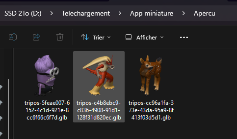

# GLB Thumbnail Provider pour l'Explorateur Windows

[](https://github.com/Sickops/glb-thumbnail-provider/actions)
[](LICENSE)


🇫🇷 Français · [🇬🇧 English](README.en.md)

Affiche une **miniature 3D des fichiers `.glb`** (glTF 2.0 binaire) directement dans l'Explorateur Windows,
comme c'est déjà le cas pour les `.3mf`.



*(Rendu de `samples/test.glb`. Remplacez cette image par une capture de votre Explorateur.)*

## Installation (utilisateurs)

1. Ouvrez la page [**Releases**](../../releases/latest).
2. Téléchargez **`GlbThumbnail_Setup_x.y.z.exe`** et lancez-le (droits administrateur requis).
3. C'est tout : les miniatures apparaissent dans l'Explorateur (affichage *Grandes / Très grandes icônes*).

> **Avertissement « Windows a protégé votre ordinateur » (SmartScreen)** : l'installateur n'est pas signé
> numériquement (certificat payant). Cliquez sur **Informations complémentaires → Exécuter quand même**.
> Vous pouvez vérifier l'intégrité avec `SHA256SUMS.txt` (`certutil -hashfile fichier SHA256`) ou compiler
> vous-même depuis les sources (voir plus bas).

### Version portable (sans installateur)
Téléchargez `GlbThumbnail_Portable_x64_x.y.z.zip`, extrayez-le dans un dossier **définitif**
(ne le déplacez plus ensuite), puis lancez `install.bat` **en administrateur**
(clic droit → *Exécuter en tant qu'administrateur*). `uninstall.bat` désinstalle.
`install.bat` redémarre l'Explorateur et vide le cache de miniatures pour voir le résultat immédiatement.

### Désinstallation
*Paramètres → Applications → Applications installées → GLB Thumbnail Provider → Désinstaller*
(ou `uninstall.bat` pour la version portable). Manuellement : `regsvr32 /u GlbThumbnail.dll` en administrateur.

## Compatibilité
- Windows 10 et 11, **64 bits** uniquement. Aucune dépendance à installer (runtime C++ intégré).
- Aucun GPU requis : le rendu est logiciel.

## Ce qui est géré
- Fichiers `.glb` autonomes (glTF 2.0 binaire), hiérarchie de nœuds, matrices et translation/rotation/échelle.
- Couleurs de matériau, couleurs de sommets, textures de couleur de base (PNG, JPEG… via WIC), alpha `MASK`.
- Extensions : `KHR_materials_unlit`, `KHR_materials_pbrSpecularGlossiness` (couleur diffuse), textures `EXT_texture_webp` (si le codec WebP est installé).
- Fond transparent, anti-aliasing, éclairage simple, caméra 3/4 de dessus ajustée au modèle.

## Limites connues
- **Draco et meshopt** (maillages compressés) : non gérés → miniature vide pour ces primitives.
- **`.gltf` + `.bin` externes** : non gérés (seul le `.glb` autonome l'est).
- Pas d'animation ni de skinning (pose de repos), pas de rendu PBR complet (pas de normal map, métal, émissif…),
  pas de textures KTX2/Basis.
- Les modèles de plus de ~2,5 millions de triangles sont sous-échantillonnés pour rester rapides.

## Dépannage
| Problème | Solution |
|---|---|
| Pas de miniature | Vérifiez l'affichage (pas *Liste/Détails*) et *Options de l'Explorateur → Affichage → décocher « Toujours afficher les icônes, jamais les miniatures »*. |
| Anciennes icônes en cache | Relancez `install.bat`, ou *Nettoyage de disque → Miniatures*, ou fermez l'Explorateur et supprimez `%LocalAppData%\Microsoft\Windows\Explorer\thumbcache_*.db`. |
| Une autre appli gère déjà `.glb` | Vérifiez `HKEY_CLASSES_ROOT\.glb\ShellEx\{E357FCCD-A995-4576-B01F-234630154E96}` : sa valeur doit être `{B7E1F4A2-6C3D-4E8A-9F15-2D7A8C0B3E64}`. Une appli tierce (visionneuse 3D, outil de miniatures) peut l'écraser : réinstallez. |
| Miniature vide pour un fichier précis | Le modèle est probablement compressé (Draco/meshopt) ou utilise un `.bin` externe. Ouvrez un ticket avec le fichier. |
| L'antivirus signale la DLL | Faux positif possible (DLL non signée qui s'enregistre dans le shell). Comparez le hash, ou compilez depuis les sources. |
| Impossible de supprimer la DLL | Elle est chargée par `dllhost.exe`/l'Explorateur : désinstallez puis redémarrez la session (l'installateur gère cela via `restartreplace`). |

## Fonctionnement technique
Une DLL COM in-process implémentant `IInitializeWithStream` + `IThumbnailProvider`, enregistrée sous
`HKLM\SOFTWARE\Classes\.glb\ShellEx\{E357FCCD-A995-4576-B01F-234630154E96}` (CLSID
`{B7E1F4A2-6C3D-4E8A-9F15-2D7A8C0B3E64}`). Windows l'exécute dans `dllhost.exe` (processus isolé : un plantage
n'affecte pas l'Explorateur). Le fichier est lu depuis le flux fourni par le shell, analysé (JSON + buffer binaire),
puis rastérisé en logiciel (z-buffer, projection orthographique, suréchantillonnage 2-3×) vers un bitmap ARGB prémultiplié.

```
src/glb_render.h      Parseur GLB/glTF + rasteriseur (code portable, sans dépendance Windows)
src/GlbThumbnail.cpp  Partie Windows : COM, WIC (textures), registre
installer/            Script Inno Setup
scripts/              build.bat, install.bat, uninstall.bat
tests/                Test du moteur de rendu (Linux/Windows) + générateur de GLB de test
samples/              GLB d'exemple
```

### Sécurité
Le fournisseur analyse des fichiers **non fiables**. Toutes les lectures sont bornées (tailles, indices, profondeur JSON,
limite de 512 Mo), mais en cas de doute, signalez-le (voir [SECURITY.md](SECURITY.md)).
Le code n'effectue **aucun accès réseau** et n'écrit aucun fichier.

## Compiler depuis les sources
Prérequis : Visual Studio 2019/2022 (ou Build Tools) avec la charge **Développement Desktop en C++**.
1. Ouvrir **x64 Native Tools Command Prompt for VS**, se placer à la racine du dépôt.
2. `scripts\build.bat` → `build\GlbThumbnail.dll` (+ scripts d'installation).
3. `build\install.bat` en administrateur pour tester.
4. Installateur : installer [Inno Setup 6.3+](https://jrsoftware.org/isdl.php), puis `ISCC installer\installer.iss` → `dist\`.

Test du moteur de rendu seul (sans Windows) :
```
g++ -std=c++17 -O2 tests/render_test.cpp -o render_test
./render_test samples/test.glb preview.ppm 256
```

## Publier une version (mainteneurs)
Mettez à jour `CHANGELOG.md`, puis : `git tag v1.1.0 && git push origin v1.1.0`.
GitHub Actions compile la DLL, génère l'installateur, l'archive portable et `SHA256SUMS.txt`, et crée la release.

## Contribuer
Issues et pull requests bienvenues, en particulier : support Draco/meshopt, `.gltf` externes, KTX2, normal maps.
Joignez un fichier `.glb` d'exemple pour tout bug de rendu.

## Licence
[MIT](LICENSE)
